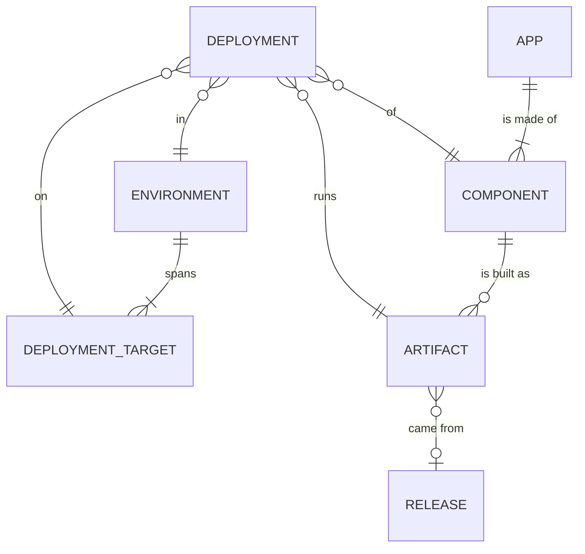

# Env Hopper

Env Hopper takes a user from "this app, in this environment" to the right URL, and tells them what is running there. Where the Backstage software catalog has a term, this glossary uses it.

## Catalog

**App**:
What the user picks and jumps into, thought of as one thing, made of one or more Components.
_Avoid_: System, application suite, product

**Component**:
A piece of software built and deployed on its own, belonging to one App.
_Avoid_: Service, module, deployable module

## Environments

**Environment**:
A stage the user picks (`dev`, `prod`), the same name for every App, however many places it physically spans.
_Avoid_: Virtual environment, env profile

**Deployment Target**:
One physical place a Component runs, such as a specific account, cluster or namespace, with its own values (hosts, monitoring names) that links are built from. Many Deployment Targets make up one Environment; the user never picks one.
_Avoid_: Location (a different thing in Backstage), physical environment

## Deployments

**Artifact**:
One built version of a Component, identified by its version string.
_Avoid_: Image, build, tag

**Release**:
Where an Artifact came from: the tag, commit, author and date that produced it. An Artifact may have none.
_Avoid_: Version (for this meaning)

**Deployment**:
The Artifact of a Component currently running in an Environment, on a Deployment Target. Only the current state exists; there is one Deployment per Component per Environment.
_Avoid_: Rollout, install

## Relationships

- A Deployment is unique per Component and Environment, and its Deployment Target belongs to that Environment.
- An Entity Provider combines one or more Sources and is the only writer of everything above.

## Integration

**Entity Provider**:
Deployment-specific code that feeds Environments, Apps, Components and Deployments into the catalog, and decides how its Sources combine when they disagree.
_Avoid_: Connector, discovery strategy

**Source**:
A package that reads one kind of infrastructure and returns neutral records about it, without deciding which App, Component or Environment they belong to. One Entity Provider combines several Sources.
_Avoid_: Adapter, plugin, module
