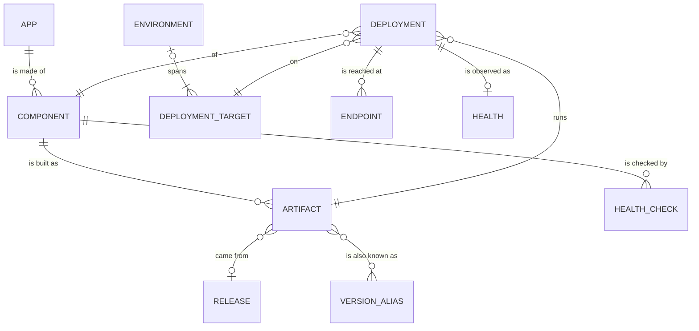

# Env Hopper

Env Hopper takes a user from "this app, in this environment" to the right URL, and tells them what is running there. Where the Backstage software catalog has a term, this glossary uses it.

## Catalog

**App**:
What the user picks and jumps into, thought of as one thing, made of zero or more Components. An App with none is links only, such as a vendor tool nobody here builds.
_Avoid_: System, application suite, product

**Component**:
A piece of software built and deployed on its own, belonging to one App.
_Avoid_: Service, module, deployable module

## Environments

**Environment**:
A stage the user picks (`dev`, `prod`), the same name for every App, however many places it physically spans. Which Deployment Targets it groups is up to the Entity Provider.
_Avoid_: Virtual environment, env profile

**Deployment Target**:
One physical place a Component runs, such as a specific account, cluster or namespace, with its own values (hosts, monitoring names) that links are built from. It is identified by the place itself, not by what a Source calls it, so two names for one namespace are one Deployment Target. Many Deployment Targets make up one Environment, and one Component may run on several of them, such as one instance per product line; the user picks the Environment, not the Target.
_Avoid_: Location (a different thing in Backstage), physical environment

## Deployments

**Artifact**:
One built version of a Component, identified by its Version.
_Avoid_: Image, build, tag

**Version**:
The exact, human-readable name of one Artifact, unique within its Component (e.g. `main-1234`). The Entity Provider derives it from whatever its Sources report, such as a pipeline id or a file name.
_Avoid_: Build number, version signal

**Version Alias**:
Another name an Artifact is known by (e.g. `2.4.0`, `spring-train`). Unlike a Version, an alias may name many Artifacts; on its own it means the most recently built of them.
_Avoid_: Tag, label, nickname

**Release**:
Where an Artifact came from: the tag, commit, author and date that produced it. One Release may produce Artifacts of several Components; an Artifact may have none.
_Avoid_: Version (for this meaning)

**Deployment**:
The Artifact a Component last deployed successfully to a Deployment Target, and so is running there now. Only the current state exists; there is one Deployment per Component per Deployment Target.
_Avoid_: Rollout, install

**Endpoint**:
A URL where one Deployment can be reached, with a kind (`ui`, `api`, `docs`, `health`) and an optional label. A Deployment has zero or more; a background worker has none.
_Avoid_: Link, page, jump (those are the hand-written URL templates)

**Health**:
The last observed condition of a Deployment: `healthy`, `degraded`, `down` or `unknown`, with when and by which Health Check it was seen. Only the current Health exists.
_Avoid_: Status (that is whether a deploy succeeded)

**Health Check**:
How the Health of a Deployment is determined, configured per Component: for example a request to its `health` Endpoint, or the readiness a cluster reports. A Component with no Health Check is `unknown`.
_Avoid_: Probe, monitor, ping

## Relationships

- A Deployment is unique per Component and Deployment Target. Which Environment it is in follows from its Deployment Target; a Deployment Target in no Environment is never offered to the user.
- An Entity Provider combines one or more Sources and is the only writer of everything above.

## Integration

**Entity Provider**:
Deployment-specific code that feeds Environments, Apps, Components and Deployments into the catalog, and decides how its Sources combine when they disagree.
_Avoid_: Connector, discovery strategy

**Source**:
A package that reads one kind of infrastructure and returns neutral records about it, without deciding which App, Component or Environment they belong to. One Entity Provider combines several Sources.
_Avoid_: Adapter, plugin, module
