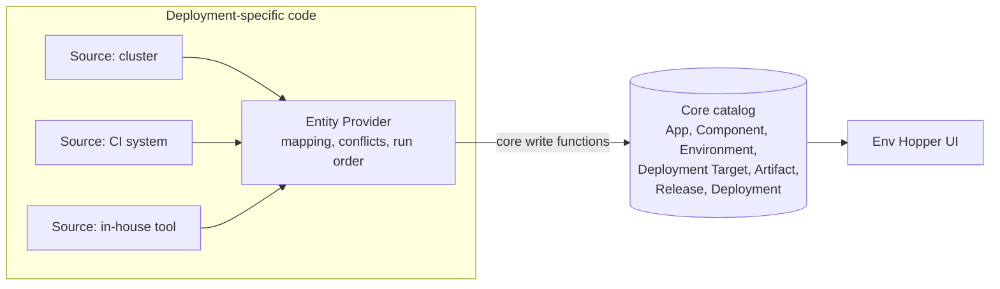

# The core holds no infrastructure concepts; deployment-specific code drives the catalog

Knowing what is deployed where needs data from sources that differ between organisations: CI systems, clusters, environment managers, software catalogs. The core defines the catalog (App, Component, Environment, Deployment Target, Artifact, Release, Deployment) and exposes functions to write it; an Entity Provider in the deployment fetches from its sources, maps them onto those terms, resolves conflicts between them, and orchestrates when it all runs. The core knows nothing about any CI system, cluster or vendor.

Reading a given kind of infrastructure is the same everywhere, so that part ships as optional Source packages (one per infrastructure, e.g. a cluster or a CI system) that depend on the core and that the core never depends on. A Source fetches and translates into neutral records; it does not decide which App, Component or Environment a record belongs to, nor who wins a conflict. The Entity Provider passes that mapping in as functions, never as Source configuration.

## Considered Options

- **Vendor adapters in the core.** Rejected: the core would depend on every infrastructure anyone uses.
- **Sources that also own the mapping** through configuration. Rejected: every organisation maps its infrastructure differently, so each Source would grow a configuration language for rules only one deployment uses.
- **Declarative mapping config in the core** (image prefix → Component, namespace → Environment, source priority). Rejected: the rules are infrastructure concepts under another name, and the conflict policy is expected to change; code in the deployment changes it without a core release.

## Consequences

- The core imposes no run order; the Entity Provider sequences its Sources, because their data depends on each other in ways only the deployment knows.
- A write to the core replaces everything a scope reports: rows the scope no longer reports are deleted, Artifacts and Environments included.
- The core has no conflict policy. Two sources disagreeing is the Entity Provider's problem, and the core stores whatever it is told.
- A software catalog such as Backstage is one more source for an Entity Provider, not a core integration. Its `System` maps onto App and its `Component` onto Component inside the provider.

## Diagram

