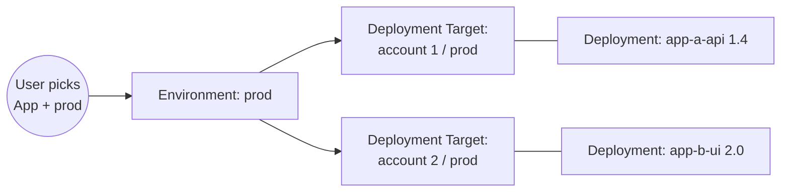

# An Environment is virtual; Deployment Targets are physical

When each App lives in its own cloud account, every account has its own `dev` and `prod`, yet users only think "prod". So the user picks an Environment, which is the same for every App, and each Deployment records the Deployment Target it physically runs on; Env Hopper resolves the real URL from the Environment, the App and that Target's values. Which Deployment Targets make up an Environment is decided by the Entity Provider (see ADR 0001), not the core.

## Considered Options

- **Every physical environment is an Environment** (`account1-prod`, `account2-prod`, ...). Rejected: the list grows with Apps × stages, and the user would have to know which account hosts which App before they could jump to it.
- **One Deployment per Component per Environment.** Rejected: a Component deployed once per product line runs several Versions in `prod` at once, and recording one would hide the rest.

## Consequences

- There is one Deployment per Component per Deployment Target, not per Environment. A Component that runs as several instances in one Environment (one per product line, regulatory context or region) has one Deployment on each, each with its own Version and host; none of them is hidden behind the others.
- Instances never become Environments, so the list the user picks from stays short. Which instance to open is chosen within the App, from its Deployment Targets.

## Diagram

