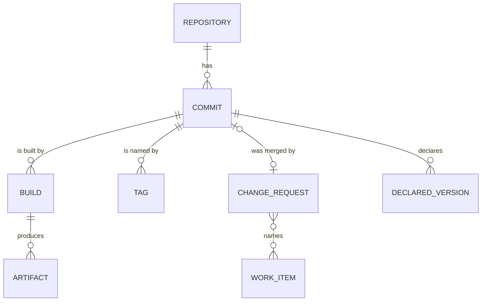

# Delivery facts are core concepts; vendors are Sources

This refines [ADR 0001](0001-core-holds-no-infrastructure-concepts.md). Naming an Artifact well (which change request it shipped, which tag, which version its code declares) needs to know how the software was made. Every CI system and code host has the same few things for that, under its own names: a repository, commits, runs of a pipeline or workflow, tags and releases, merge or pull requests, the tracker tickets they name, and version files. They are not one vendor's concepts, so the core names them, and a Source maps its own objects onto them: a pipeline is a Build, a merge request is a Change Request.

The core keeps them as **delivery facts**: Repository, Commit, Build, Tag, Change Request, Work Item and Declared Version. An Entity Provider writes them with `writeFacts` and reads them back with `readFacts`; an Artifact names the Build that made it.

- **Written once.** A delivery fact is what a Source said about something that already happened. No sync updates or deletes one. A column read as NULL (a Build still running, a Change Request not yet merged) may be filled once later; a stored value never changes. Two writers of the same fact are harmless.
- **Work Items are snapshots.** A tracker ticket's title and type do change, so a Work Item is replaced by each newer read and carries when it was read (`readAt`).
- **Users by username.** A fact names a User by username, as a plain value: Users are synced and deleted per scope, and a fact must outlive them. The core matches no identities across Sources.
- **No foreign keys** between delivery facts, or from them to Users or Artifacts. Nothing is deleted, so nothing cascades, and a fact may be written before or after the facts it names (an Artifact may name a Build not stored yet).
- **Keys are the Source's ids**, prefixed with the Source (`gitlab:42` for a repository, `jira:SHOP-7` for a Work Item).
- **Where a Declared Version is read from** (which file, which field) is provider configuration, not part of the fact. The fact is the value a Commit declares for one type, or that it declares none.
- **What is not known yet, and when to ask again,** is the provider's own fetching state (ADR 0001), not a core table.

These are not the **Facts** of [ADR 0006](0006-read-cache-and-hot-pairs.md): a Fact there is a provider's remembered read, which expires and is refreshed. A delivery fact never expires; it is what such a read found out about how software was made.

## Considered Options

- **Keep it in each provider**, in its own tables or in memory. Rejected: every provider would rebuild the same Repository, Build and Change Request model, and a restart would read the CI server again for things that can never change.
- **Vendor-shaped tables** (pipelines, merge requests). Rejected: the core would hold one vendor's concepts (ADR 0001), and a second CI system would need its own tables.
- **Sync delivery facts per scope**, like the catalog. Rejected: a run that no longer lists a build would delete what is still true about it.

## Consequences

- A restart costs a provider almost no reads of its CI server: what it once learned is stored.
- Release (`syncReleases`) is unchanged for now. Later, a Release becomes a view over Tag, Commit and Build.

## Diagram

